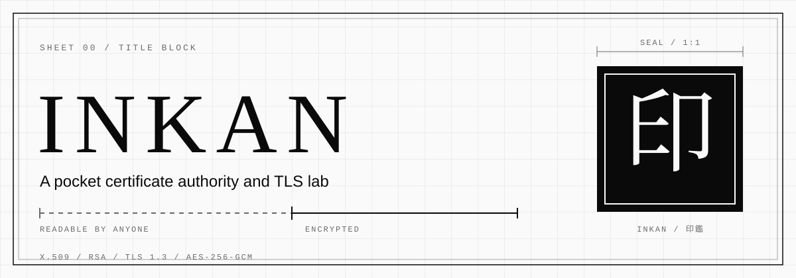
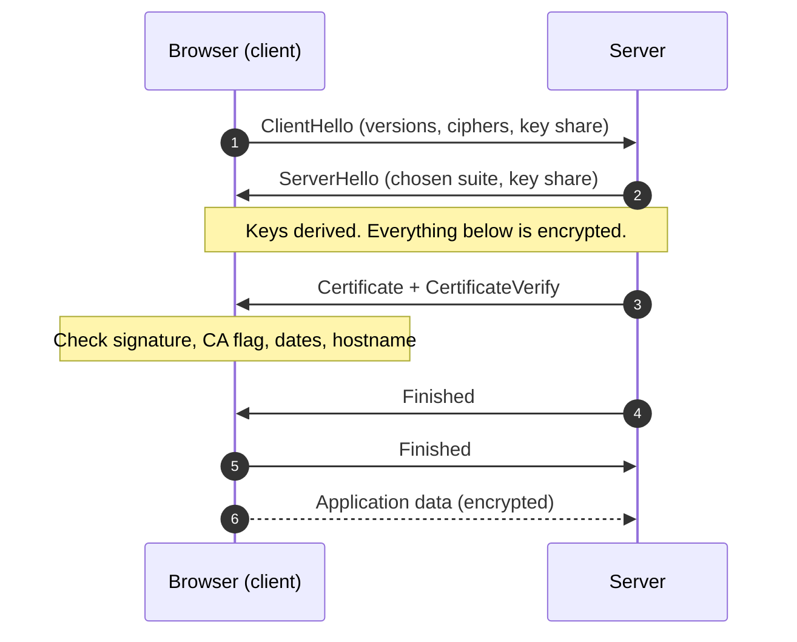
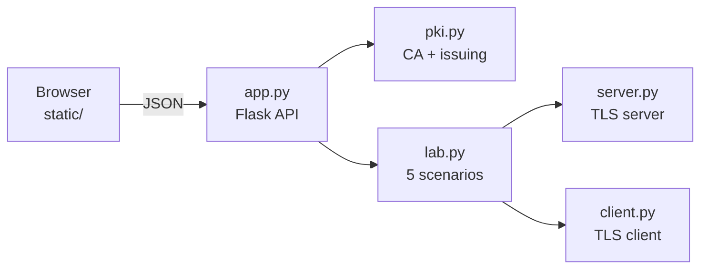

<div align="center">

<picture>
  <source media="(prefers-color-scheme: dark)" srcset="assets/banner-dark.svg">
  
</picture>

<br>


**Be the authority. Sign a certificate. Watch a real TLS handshake accept it or shut the gate.**

[](https://inkan.onrender.com)

[What it is](#-what-it-is) ·
[Four sheets](#-the-four-sheets) ·
[The gauntlet](#-the-gauntlet) ·
[Handshake](#-the-tls-13-handshake) ·
[Run it](#-run-it) ·
[Deploy](#-deploy) ·
[API](#-api) ·
[Limits](#-limits)

</div>

<br>

## 印 What it is

In Japan, an **inkan** (印鑑) is a registered seal. Stamp it on a contract and the document becomes official, because everyone already trusts that seal.

A **certificate authority (CA)** does the same for the web. Its signature on a certificate tells your browser: *this public key really belongs to this website.*

Inkan lets you play every role in that story, in the browser, with real cryptography underneath:

```
        ┌──────────────┐   signs    ┌──────────────────┐   presents   ┌──────────────┐
        │  Authority   │ ─────────► │   Certificate    │ ───────────► │   Browser    │
        │  (the seal)  │            │ shop.example.com │              │ (the checker)│
        └──────────────┘            └──────────────────┘              └──────┬───────┘
               ▲                                                             │
               └──────────── "do I already trust this seal?" ◄───────────────┘
```


<br>

## 01 – 04 The four sheets

The interface is laid out like an engineering drawing set. Each sheet is one step of the trust chain.

| Sheet | Name | What happens |
|:---:|---|---|
| **01** | **Authority** | Generates a key pair and a self-signed root certificate. This is the party everyone trusts. |
| **02** | **Certificate** | Generates the website's key pair, then the CA signs it, binding a hostname to that key. Optionally issue one that is already expired. |
| **03** | **Inspection** | Runs the checks a browser runs: signature, CA flag, validity dates, hostname. Includes a **Tamper** button that breaks the signature, and **Trust another authority** to break the chain. |
| **04** | **Gauntlet** | Starts a real TLS server on loopback and connects to it five times, each with a different problem. |

<br>

## ▣ The gauntlet

Five real TLS handshakes. One gate opens, four shut, and each shows the genuine reason.

| Gate | Result | Reason shown |
|---|:---:|---|
| Valid certificate | **OPEN** | TLS 1.3, AES-256-GCM |
| Unknown CA | **SHUT** | unable to get local issuer certificate |
| Expired certificate | **SHUT** | certificate has expired |
| Wrong hostname | **SHUT** | hostname mismatch |
| Legacy TLS 1.1 client | **SHUT** | no protocols available |

> **Honest note on the last gate.** Modern Python and OpenSSL refuse to speak TLS 1.1 on the *client* side, so that rejection is the client declining, not the server. It still shows that old protocol versions are no longer accepted.

<br>

## ◈ The TLS 1.3 handshake

The page opens with a live animation of this exchange. The wire goes from dashed (readable by anyone) to solid (encrypted) at the moment the keys are agreed.



<details>
<summary><b>Why does a certificate exist at all?</b></summary>

<br>

Key agreement alone does not tell you *who* you agreed a key with. Without authentication, an attacker in the middle could agree one key with you and another with the server. A certificate proves the public key belongs to the named website, and the CA's signature is what lets you believe it.

</details>

<details>
<summary><b>What does the CA's signature actually do?</b></summary>

<br>

The CA hashes the certificate's contents and signs the hash with its **private** key. Anyone holding the CA's **public** key can verify that signature. Change a single bit of the certificate and verification fails, which is exactly what the **Tamper** button demonstrates.

</details>

<details>
<summary><b>What does a browser check?</b></summary>

<br>

1. The **signature** verifies against a trusted CA's public key.
2. The signer is actually allowed to be a CA (the **CA flag** is set).
3. Today's date falls inside the **validity period**.
4. The **hostname** matches the certificate's name.

</details>

<br>

## ▸ Run it

```bash
pip install -r requirements.txt
python app.py
```

Open **http://localhost:8000**.

On Windows, if `pip` is not recognised, use the launcher instead:

```powershell
py -m pip install -r requirements.txt
py app.py
```

Run the backend tests:

```bash
python -c "import test_app as t; t.test_flow(); t.test_bad_input(); t.test_lab_and_static()"
```

<br>

## ▲ Deploy

Everything needed is already in the repo.

| Platform | Steps |
|---|---|
| **Render** | Push to GitHub, then **New › Blueprint** and pick this repo. `render.yaml` and the `Dockerfile` do the rest. |
| **Railway / Heroku** | Push the repo. The `Procfile` runs gunicorn on `$PORT`. |
| **Docker** | `docker build -t inkan .` then `docker run -p 8000:8000 inkan` |

> The free Render tier sleeps when idle. Open the link once before a demo to wake it.

<br>

## ⌗ API

| Route | Purpose |
|---|---|
| `POST /api/ca` | Create a root CA (returns PEM certificate, key and details) |
| `POST /api/issue` | Issue a server certificate from a CA |
| `POST /api/inspect` | Read the fields of a PEM certificate |
| `POST /api/verify` | Check signature, CA flag, validity dates and hostname |
| `POST /api/lab` | Run five real TLS handshakes on loopback |
| `GET /healthz` | Health check |

<br>

## ⊞ How it fits together



```
inkan/
├── app.py            Flask API, also serves the frontend
├── pki.py            create a CA, issue and sign certificates
├── server.py         TLS server used by the gauntlet
├── client.py         strict TLS client (verification on)
├── lab.py            the five handshake scenarios
├── test_app.py       backend tests
├── static/
│   ├── index.html    page structure
│   ├── app.js        interactions, handshake animation, cursor
│   ├── tokens.css    design tokens (Blueprint system)
│   ├── components.css
│   └── style.css     Inkan-specific styles
├── Dockerfile · Procfile · render.yaml · requirements.txt
└── LICENSE
```

<br>

## ◐ Design

The interface uses a monochrome drawing-sheet system. Pass and fail are told apart by **line type**, never by colour alone.

| | Pass | Fail |
|---|---|---|
| Check row | solid left border, `PASS` tag | double border, `FAIL` tag |
| Seal | solid ring | double ring |
| Wire | solid (encrypted) | dashed (readable) |

Light and dark themes, a drafting-crosshair cursor with live coordinates, per-certificate fingerprints, and reduced-motion support are all built in. The custom cursor switches on for mouse users only.

**Type:** Libre Caslon Display (headings) · IBM Plex Sans (body) · IBM Plex Mono (PEM and fingerprints) · Noto Serif JP (印鑑).

<br>

## ⚠ Limits

This is a **learning tool**, not a production CA.

- **Stateless by design.** Nothing is stored on the server. Keys are generated for practice and returned to the browser. Never paste a real private key.
- **No revocation** (CRL / OCSP).
- **No client certificates** (no mutual TLS).
- **No login or rate limiting.** The gauntlet starts real servers, so it is the costliest endpoint. Add something like Flask-Limiter before sharing a public link widely.
- **No certificate transparency**, no intermediate CAs, and RSA only.

<br>

## License

MIT, see [LICENSE](LICENSE).

<div align="center">

<br>

印 &nbsp; *a seal is only worth the trust behind it.* &nbsp; 印

</div>
